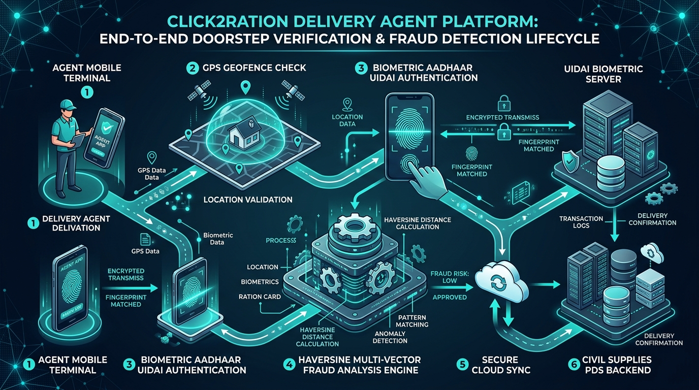

# Click2Ration - Delivery Agent Portal

Click2Ration (C2R) Delivery Agent Portal is a secure, field-grade web application engineered for public distribution system (PDS) delivery personnel. It enables authenticated doorstep ration delivery through Aadhaar-based biometric identity verification, real-time GPS coordinate logging, and a continuous multi-vector anomaly detection engine to prevent distribution leakages, proxy deliveries, and jurisdictional fraud.

---

## System Architecture and Operational Flow



The system enforces a zero-trust verification pipeline connecting field terminals with biometric hardware abstraction layers, geolocation services, and government audit registries.

---

## Core Capabilities

- **Biometric Aadhaar Identity Verification**: Direct integration flow for Mantra RD Service biometric scanner interface, providing UIDAI Aadhaar biometric matching before ration allotment handover.
- **Automated Multi-Vector Fraud Detection**: Real-time evaluation of GPS geofencing, delivery velocity, biometric retry anomalies, and operational zone limits.
- **Geographic Location Fusion**: Instant capture of high-precision latitude and longitude coordinates with fallback mesh for low-connectivity regions.
- **Delivery Ledger Management**: Centralized queue of assigned deliveries with real-time status transitions (Pending, In Progress, Delivered) and parcel commodity manifests.
- **Incident and Review Triage**: Automated flagging of anomalous deliveries into an administrative investigation registry for civil supply authorities.
- **Optimized Mobile UX**: Responsive touch-first user interface built with Tailwind CSS, Radix UI primitives, and Lucide vector iconography.

---

## Anti-Fraud and Anomaly Detection Engine

The fraud detection subsystem runs synchronously upon each delivery confirmation event, executing four discrete heuristic evaluations:

### 1. Haversine Geographic Distance Check
Measures the physical distance between the agent's live GPS coordinates and the beneficiary's registered residence coordinates using the Haversine formula:

```text
a = sin²(Δlat / 2) + cos(lat1) * cos(lat2) * sin²(Δlng / 2)
c = 2 * atan2(√a, √(1 - a))
Distance (km) = R * c  (where R = 6371 km)
```

- **Threshold**: Deliveries exceeding 5.0 km from registered address are flagged as `GPS Anomaly`.

### 2. Velocity and Speed Anomaly Detection
Calculates the elapsed time between consecutive completed deliveries:

```text
Interval = (Timestamp_current - Timestamp_previous) / (1000 * 60)
```

- **Threshold**: Deliveries completed within less than 5.0 minutes of each other trigger a `Speed Anomaly` flag for impossible travel velocity.

### 3. Biometric Failure Rate Monitoring
Tracks cumulative failed biometric capture attempts prior to a successful match:

- **Threshold**: Exceeding 3 failed attempts triggers a `Biometric Anomaly` flag to prevent coercion and unauthorized proxy attempts.

### 4. Jurisdictional Zone Geofencing
Validates that the delivery transaction occurs within the authorized district operational radius:

- **Threshold**: Deliveries outside the 25.0 km radius from the assigned administrative hub center are flagged as `Zone Anomaly`.

---

## Technology Stack

| Layer | Technologies |
| :--- | :--- |
| **Frontend Framework** | React 18 with TypeScript |
| **Build & Bundler Tooling** | Vite with SWC compiler |
| **Styling & Design System** | Tailwind CSS, PostCSS, class-variance-authority, clsx |
| **Component Architecture** | Radix UI primitives, Lucide React icons, Sonner notifications |
| **State & Data Management** | React Context API, TanStack Query (React Query) |
| **Routing** | React Router DOM v6 |
| **Testing Suite** | Vitest, Testing Library, JSDOM |

---

## Directory Structure

```text
ddelivery_agent_app/
├── docs/
│   └── assets/
│       └── system_flow.jpg        # Architecture & system flow infographic
├── public/
│   ├── placeholder.svg
│   └── robots.txt
├── src/
│   ├── components/
│   │   ├── ui/                    # Accessible UI component library
│   │   ├── AppLayout.tsx          # Main authenticated layout and navigation
│   │   └── NavLink.tsx
│   ├── context/
│   │   ├── AuthContext.tsx        # Authentication state & session store
│   │   ├── DeliveryContext.tsx    # Deliveries queue & metrics state
│   │   └── FraudContext.tsx       # Real-time fraud detection state & log triage
│   ├── hooks/
│   │   ├── use-mobile.tsx         # Mobile viewport detector
│   │   └── use-toast.ts           # Toast notifications hook
│   ├── lib/
│   │   ├── fraud-detection.ts     # Multi-vector fraud detection logic
│   │   ├── mock-data.ts           # Beneficiaries & assigned delivery ledger
│   │   └── utils.ts               # Class merging utilities
│   ├── pages/
│   │   ├── Dashboard.tsx          # Daily metrics & delivery progress overview
│   │   ├── Deliveries.tsx         # Assigned parcel queue list
│   │   ├── FraudAlerts.tsx        # Flagged anomaly review portal
│   │   ├── Login.tsx              # Agent authentication interface
│   │   ├── NotFound.tsx           # Route fallback page
│   │   └── Verify.tsx             # Biometric & GPS confirmation wizard
│   ├── App.css
│   ├── App.tsx                    # Route definitions & global providers
│   ├── index.css                  # Design tokens & color variables
│   └── main.tsx                   # Application entry point
├── eslint.config.js
├── index.html                     # Application HTML entry point
├── package.json
├── tailwind.config.ts             # Tailwind design system configuration
├── tsconfig.json
├── vite.config.ts                 # Vite bundler configuration
└── vitest.config.ts
```

---

## Getting Started

### Prerequisites

- Node.js (v18.0.0 or higher recommended)
- npm or yarn or pnpm or bun

### Installation

1. Clone the repository:
   ```bash
   git clone https://github.com/Kishore-dev-21/C2R_DeliveryAgent.git
   cd C2R_DeliveryAgent
   ```

2. Install dependencies:
   ```bash
   npm install
   ```

3. Start the local development server:
   ```bash
   npm run dev
   ```

4. Build for production:
   ```bash
   npm run build
   ```

5. Run test suites:
   ```bash
   npm run test
   ```

---

## Demo Credentials

For testing and demonstration, use the pre-configured credentials:

| Field | Demo Value |
| :--- | :--- |
| **Agent ID** | `AGT001` |
| **Password** | `click2ration` |
| **Assigned Hub** | Chennai Central Distribution Sector |

---

## Verification and Delivery Protocol

1. **Authentication**: Agent logs in with assigned credentials to fetch the route ledger.
2. **Parcel Selection**: Agent selects a beneficiary from the pending delivery roster.
3. **Hardware Connectivity**: Terminal establishes connection with the Mantra RD scanner service.
4. **Biometric Capture**: Beneficiary fingerprint is captured and verified against Aadhaar records.
5. **GPS Geotagging**: Real-time GPS coordinates are captured and fused with the transaction record.
6. **Fraud Engine Execution**: Multi-vector heuristics analyze distance, velocity, attempt counts, and perimeter.
7. **Confirmation & Ledger Update**: Delivery is marked as completed and synced with backend registry.

---

## License

This project is licensed under the MIT License.
